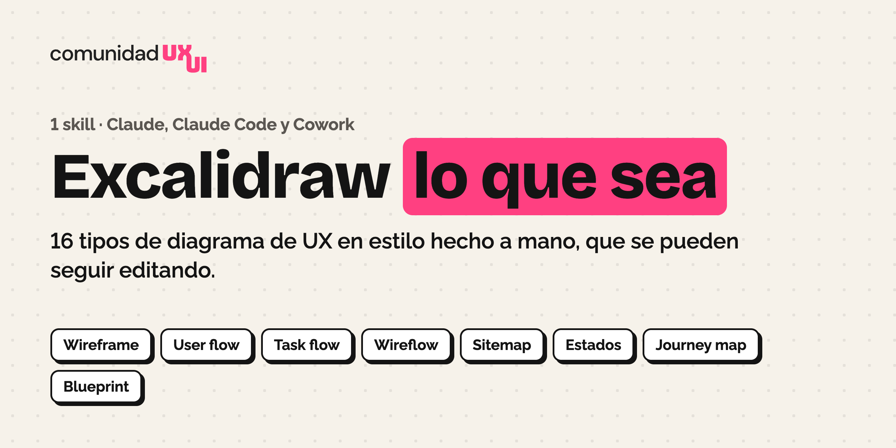
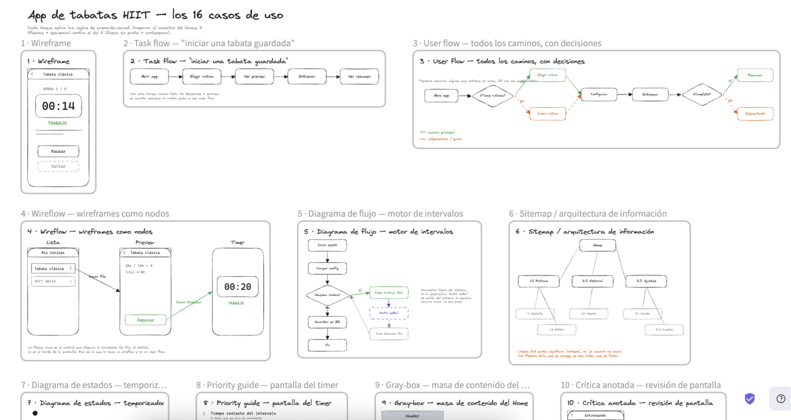

<p align="center"></p>

# Excalidraw UX

**Diagramas de UX hechos a mano que se pueden seguir editando:** wireframes, user flows, sitemaps, diagramas de estado, journey maps y once tipos más.

[](LICENSE)
[](skills/)
[](#en-claude-code)
[](#)

---

Genera **archivos `.excalidraw` de verdad**: los abres en Excalidraw, mueves una caja y la flecha la sigue. No son imágenes de un diagrama: son el diagrama.



## Qué resuelve

Cuando le pides un diagrama a una IA pasa una de dos cosas: te da una imagen linda que no puedes tocar, o un diagrama que mezcla convenciones y dice algo distinto de lo que querías.

El caso típico es un sitemap dibujado con flechas. Con flechas estás diciendo «la persona navega en este orden». Lo que querías decir era «esta sección contiene a esta otra». Quien lo lee lo entiende mal.

Esta skill hace dos cosas:

1. **Construye los elementos nativos de Excalidraw**, con las flechas ancladas a las cajas. El trazo a mano alzada lo pone el motor de Excalidraw, no un modelo de imagen: sale exacto y editable.
2. **Sabe qué diagrama corresponde a cada pedido y cuáles son sus reglas.** No necesitas saber el nombre técnico: pides «muéstrame cómo sería la app» y te dice cuál eligió y por qué. Las convenciones salen de la práctica establecida (NN/g, IxDF, ISO 5807, Garrett).

## Los 16 tipos

**Los de todos los días:** wireframe · user flow · task flow · wireflow · diagrama de flujo

**Frecuentes:** sitemap o arquitectura de información · diagrama de estados · priority guide · gray-box · crítica anotada · matriz 2×2

**Para research y estrategia:** journey map · service blueprint · swimlanes · mapa de afinidad · storyboard

Cada uno con sus reglas de layout, notación y qué NO va, en [`casos-de-uso.md`](skills/excalidraw-visualizations/casos-de-uso.md).

## Cómo se usa

Le hablas normal:

- *«Haz un user flow del alta de cuenta.»*
- *«Haz un diagrama de los estados del reproductor.»*
- *«Arma el sitemap del sitio.»*
- *«Revisa esta pantalla y anota los problemas.»*

Si eligió mal el tipo de diagrama, se lo corriges y lo rehace. El ejemplo [`muestrario.excalidraw`](skills/excalidraw-visualizations/ejemplos/muestrario.excalidraw) trae los 16 tipos aplicados a una app de entrenamiento: ábrelo en [excalidraw.com](https://excalidraw.com).

## Instalación

### En claude.ai y en Cowork

1. Descarga `excalidraw-visualizations.zip` desde **[Releases](https://github.com/ComunidadUXUI/excalidraw-ux/releases/latest)**.
2. En Claude, entra a **Personalizar → Skills → + → Subir una skill** y súbelo tal como lo descargaste.
3. Abre un chat nuevo y pide lo que necesitas.

Guía paso a paso con capturas: **[cómo subir una skill a claude.ai](NOTION_LINK)**.

### En Claude Code

```
/plugin marketplace add ComunidadUXUI/excalidraw-ux
/plugin install excalidraw-ux@excalidraw-ux
```

Después pide lo que necesitas o llama la skill directo: `/excalidraw-visualizations`.

### En Codex, Cursor, Gemini CLI y otros agentes

```bash
npx skills add ComunidadUXUI/excalidraw-ux
```

Necesita Node.js 22.20 o superior. Si tu agente no instala skills, deja el repositorio en tu carpeta de trabajo y pídele que lea el `SKILL.md` de la carpeta `skills/` y lo siga.

Para dibujar los archivos en Claude Code necesita Node.js 18 o superior.

## Generar imágenes (opcional)

También puede generar imágenes PNG con IA, para una ilustración difícil de armar con formas simples. Eso necesita una clave de [kie.ai](https://kie.ai): copia `.env.example` a `.env` y pégala ahí. **Sin clave la skill funciona igual:** los archivos `.excalidraw` no dependen de ningún servicio.

## Qué hay adentro

```
skills/excalidraw-visualizations/
├── SKILL.md                    instrucciones para la IA
├── casos-de-uso.md             qué diagrama corresponde a cada pedido y sus reglas
├── style-guide.md              paleta, tipografías y formas
├── scripts/
│   ├── excalidraw-builder.js   formas, conectores anclados y layout
│   ├── ui-kit.js               piezas de wireframe (pantalla, botón, campo, interruptor)
│   └── generate-visual.js      imágenes con IA (opcional)
└── ejemplos/                   el muestrario con los 16 tipos
```

### Usarlo como librería

Los scripts funcionan sueltos, sin IA:

```js
const B = require('./skills/excalidraw-visualizations/scripts/excalidraw-builder.js');
const T = B.THEMES.light;

const a = B.box({ x: 0, y: 0, w: 160, h: 60, label: 'Inicio', color: T.ink });
const b = B.box({ x: 0, y: 200, w: 160, h: 60, label: 'Fin', color: T.ok });
const els = [...a, ...b, ...B.connect(a[0], b[0], { label: 'siguiente' })];

require('fs').writeFileSync('mi.excalidraw',
  JSON.stringify(B.document(els, { theme: 'light' }), null, 2));
```

`connect(a, b)` dibuja una flecha (secuencia o transición). `link(a, b)` dibuja una línea sin punta (contenencia o jerarquía, para sitemaps y árboles). Los dos quedan anclados.

## Límites honestos

- **En claude.ai la skill funciona, pero el archivo lo descargas tú** y lo abres en excalidraw.com.
- **No reemplaza a Figma** cuando necesitas un prototipo clickeable: genera diagramas, no prototipos.
---

## Diagramas que comunican

Elegir el diagrama correcto es criterio de diseño. Lo practicamos en **[Comunidad UX/UI](https://www.skool.com/comunidaduxui/about)** con feedback sobre tus propios flujos y mapas.

¿Prefieres empezar por correo? Suscríbete a **[Minuto UX](https://comunidad-uxui.kit.com/fb40f8e711)**, el newsletter de Comunidad UX/UI.

**Más skills de Comunidad UX/UI:** [Auditoría UX con IA](https://github.com/ComunidadUXUI/auditoria-ux-con-ia) · [Diseño guiado con IA](https://github.com/ComunidadUXUI/diseno-guiado-con-ia) · [Crea tu asesor](https://github.com/ComunidadUXUI/crea-tu-asesor) · [Modo Fable](https://github.com/ComunidadUXUI/modo-fable) · [Ahorro de tokens](https://github.com/ComunidadUXUI/ahorro-de-tokens)

## Licencia

[CC BY-NC-SA 4.0](LICENSE). Puedes usarla, adaptarla y compartirla citando a Comunidad UX/UI, sin uso comercial y con la misma licencia.
